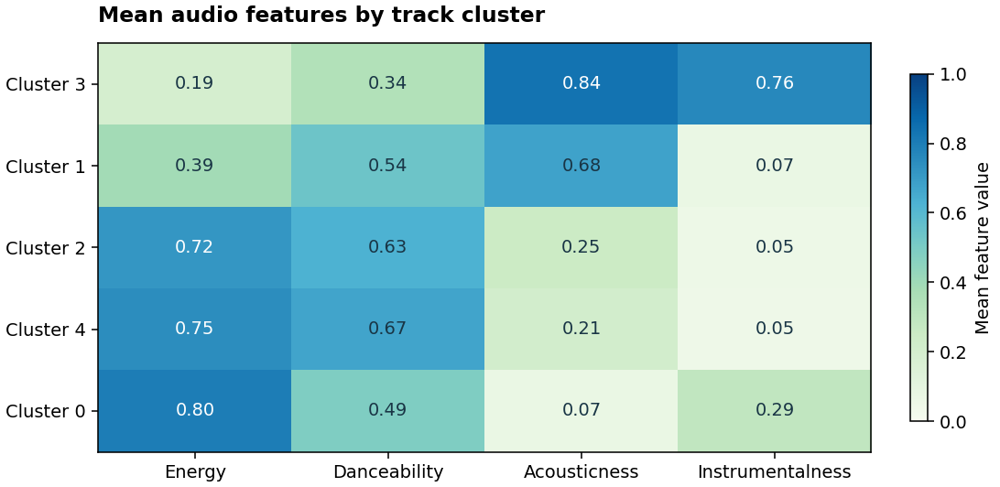

# Beyond Genre · Spotify track analysis

We wanted to know whether songs with similar audio features cluster together and whether those features help predict popularity. The notebook uses K-means for the first question and compares linear regression against a simple baseline for the second.

**Pardha Saradhi Edupalli, Eric Akwei, Lakshmi Aishwarya Undi and George Owusu Dame** · University of Cincinnati



## Results

The class CSV contains 114,000 rows. Deduplicating track IDs and dropping incomplete rows leaves **89,740 tracks**. The notebook compares cluster inertia from k = 1 through 10 and uses five clusters to examine differences in audio features. One cluster has substantially higher mean instrumentalness than several others, while another combines high energy with low acousticness.

| Popularity model | Result |
| --- | --- |
| Training / test tracks | 71,792 / 17,948 |
| Held-out R² | 0.0325 |
| Model RMSE | 20.12 popularity points |
| Training-mean baseline RMSE | 20.45 popularity points |

The linear model improves only slightly on predicting the training-set mean. Audio features are more informative here for describing track profiles than for predicting an individual track’s popularity. Genre and cluster identifiers follow the original notebook’s integer encoding, which imposes an arbitrary ordering.

## Reproduce

Download the Spotify Tracks Dataset and place its CSV at `data/dataset.csv`. [Dataset source and file details](data/README.md)

Run these commands in PowerShell from this project folder with Python 3.12 installed.

```powershell
py -3.12 -m venv .venv
.\.venv\Scripts\python -m pip install -r requirements.txt
.\.venv\Scripts\python -m jupyter lab analysis.ipynb
```

Run the cells in order. The plots use all 89,740 cleaned tracks. For the prediction experiment, the notebook fits the scaler and K-means on the training split before assigning the held-out tracks to clusters.
